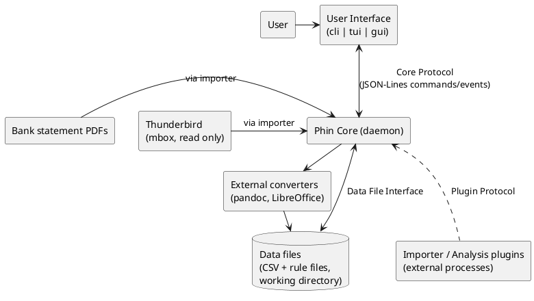
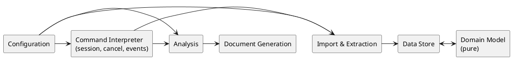
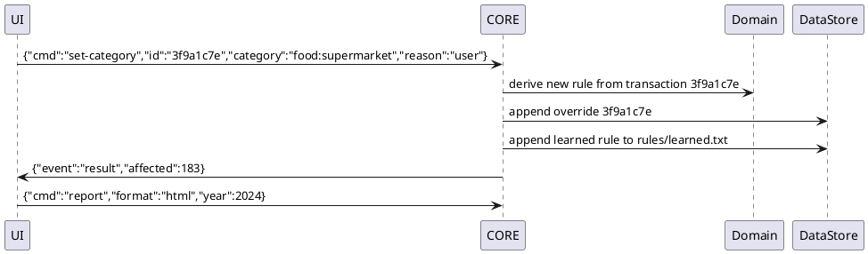

# Introduction and Goals

## Requirements Overview

| ID  | Requirement                                                           | Explanation |
|-----|-----------------------------------------------------------------------|-------------|
| 001 | Gather financial data from bank statements                            | Bank statement PDFs (text layer, no OCR) are read and the transactions contained in them are extracted. |
| 002 | Refine financial data from other sources like E-Mails                 | Data from the Thunderbird mail storage (mbox files, including attached invoices) is added as *annotation* on top of the statement data, never as new transactions. |
| 003 | Classify financial data automatically                                 | Classification is derived from rule files; it is never stored per transaction. |
| 004 | The user can refine current and future classifications                | A correction made by the user is stored as an override *and* teaches a rule that is applied to existing and future transactions. |
| 005 | Creates human readable documents with analysis results                | Analyses are rendered as Markdown or HTML; PDF and LibreOffice/ODS output is delegated to external converters. |

## Quality Goals

| ID  | Quality Goal    | Explanation |
|-----|-----------------|-------------|
| Q1  | Correctness     | Amounts are exact (integer minor units), no data is ever lost or silently overwritten, and re-running the pipeline yields the same result (idempotence). |
| Q2  | Usability       | The tool is usable by a non-programmer via the command line; the stored data and the rules are human readable and human editable. |
| Q3  | Flexibility     | New user interfaces, new importers and new analyses can be added without changing the core pipeline. |

## Stakeholders

| Role/Name | Contact | Expectations |
|-----------|---------|--------------|
| User      | –       | Single private user on their own computer; owns their data files and may edit them at any time. |

# Architecture Constraints

| Constraint | Explanation |
|------------|-------------|
| Implemented in Rust | Because I want to learn Rust. |
| Local only | Nothing leaves the user's computer; no cloud, no account, no server. |
| Two processes | The core runs as a daemon; the user interface is a separate process that talks to it over a serialized protocol. |
| Single currency | Only one settlement currency is modelled for now; the currency is still carried as a field so that multi-currency remains a data change. |
| CSV / text files | Storage and rules are plain, human editable text files. |
| Plugins are external processes | No embedded scripting engine, no dynamic Rust plugin ABI. |
| Core transport is a local TCP stream | The core daemon and the interface processes exchange JSON-Lines over a stream on `127.0.0.1`; the address is configurable with a fixed default, so the same mechanism works on Linux, Windows and macOS. |
| PDF text layer comes from an external tool | `pdftotext` (poppler-utils, `-layout`) is called by the core; a native library (`pdfium`) is the recorded alternative. |
| Linux is the main target | Windows and macOS must remain possible, therefore no Linux-only API may be used in the core. |

# Context and Scope

## Business Context

| External System | Interface |
|-----------------|-----------|
| user | CLI, TUI or GUI process; commands and events over the Core Protocol |
| bank statements | PDF files with a text layer, given by path |
| Thunderbird | read-only mbox files under the profile (`ImapMail/<server>/<Folder>`, `Mail/…`); `global-messages-db.sqlite` is used only as an optional optimization |
| external converters | `pandoc`, LibreOffice (`--convert-to`) for PDF and ODS export |
| importer / analysis plugins | external executables speaking the Plugin Protocol |

## Technical Context

Currently no external parts outside the user's computer are planned. The mail data of the user is large (≈ 4.4 GB of mbox files across four accounts), so the mail importer has to be incremental. The Thunderbird databases may be locked while Thunderbird is running, so they must be opened read-only and treated as optional.

# Solution Strategy

Phin is a small, personal, single-user accounting tool. The whole system is a **data pipeline over plain text files**:

`extract → deduplicate → store → (derive classification) → analyse → document`

The pipeline is **idempotent**: it can be re-run at any time and produces the same result, which makes crash recovery and re-imports trivial and removes the need for an "update in place" strategy.

The **domain model** (financial transaction, category tree, annotation, rule) is kept separate from the technical parts (parsing, file access, process management) and is expressed as pure functions over data. Everything that a user can change – categories, rules, overrides, annotations – is *data*, never code.

Communication inside the system uses exactly **one interchange format, JSON-Lines**, in two vocabularies: the *Core Protocol* (UI ⇄ core daemon, command-shaped, with interleaved progress/log/error events) and the *Plugin Protocol* (core ⇄ plugin process). The core itself stays single-threaded; progress reporting and cancellation are provided by the event stream, not by concurrency.

# Building Block View

## Whitebox Overall System

Motivation

:   The system is deliberately split into two processes so that the user interface can be replaced without touching the core, and so that the core can be driven by any program, not only by the three interfaces that ship with Phin.

Contained Building Blocks

:   **User Interface** (see Level 2), **Phin Core** (see Level 2). The plugin processes, the data files and the external converters are part of the environment, not of the system.

Important Interfaces

:   **Core Protocol** (JSON-Lines over a pipe/socket): commands in, events out. **Plugin Protocol** (JSON-Lines over a pipe): `probe` / `extract` for importers, `analyse` for analyses. **Data File Interface**: the human editable text files in the working directory.

## Level 1

### User Interface (black box)

Purpose/Responsibility

:   Present the current state to the user and translate what the user wants into core commands. It owns no financial knowledge at all: it only knows the protocol.

Interfaces

:   Implements the Core Protocol as client: sends commands, consumes events (`result`, `progress`, `log`, `error`, `cancelled`).

Directory/Location

:   `phin-cli/`, `phin-tui/`, `phin-gui/` (one executable each).

Fulfilled Requirements

:   Entry point for all requirements.

### Phin Core (black box)

Purpose/Responsibility

:   Owns the whole pipeline, the session state, the data files and the rule engine. Runs as a daemon that reads commands on stdin and writes events on stdout.

Interfaces

:   Core Protocol (server side), Data File Interface, Plugin Protocol (host side), external converter calls.

Directory/Location

:   `core/`.

Fulfilled Requirements

:   001–005.

### Interface Core Protocol

:   Line based, one JSON object per line, versioned by a `v` field. Commands are verb first (`{"cmd":"import","path":"…"}`). Events are `{"event":"progress",…}`, `{"event":"result",…}`, `{"event":"log","level":"info",…}`, `{"event":"error",…}`. A `cancel` command is honoured between items. The vocabulary is data driven: command names and their parameters are described in a table that both sides read, so adding a command does not require changes in the interface layer.

### Interface Plugin Protocol

:   Same JSON-Lines encoding, different vocabulary. Importer: `probe {file} -> {supported: bool, kind}` and `extract {file} -> transactions`. Analysis: `analyse {transactions, categories} -> table`. Plugins are discovered from the configuration; they must be executable and are started as separate processes.

## Level 2

### White Box Phin Core

#### Command Interpreter

:   Reads one command, drives the corresponding pipeline step, emits events, checks for cancellation between items. The only place where the protocol is understood on the core side.

#### Import & Extraction

:   Host framework that hands a file to the importers: `probe` every configured importer, then `extract` from the ones that accepted it. Contains the two built-in importers (bank statement PDF, Thunderbird mbox reader) and the contract for plugin importers. The mbox importer is incremental: it remembers a marker per mbox file in the data directory. Fulfils 001 and 002.

#### Domain Model

:   The pure part: `Financial Transaction` (id, date, amount as integer minor units, currency, description, counterparty, source), `Category` tree, `Annotation`, `Rule`, and the rule engine that derives the category of a transaction from rules plus overrides. No file access, no process management, no protocol. Everything here is unit testable on its own.

#### Data Store

:   Append-only reader/writer for the text files: `transactions.csv` (facts, never rewritten), `annotations.csv`, `overrides.csv`, `categories.csv`, `rules/` (plain text rule files). Writes are atomic (write temporary file, rename). Merges the side files on read.

#### Analysis

:   Built-in analyses (income/expense per category per year, cash flow, monthly statistics, biggest spendings) plus the host for analysis plugins. Fulfils 005.

#### Document Generation

:   Renders analysis results as Markdown and HTML natively; delegates PDF and ODS to the external converters.

#### Configuration

:   TOML configuration: which interface, which mail folders to scan, which plugins, which converters, data directory (defaults to the current directory).

### White Box User Interface

:   Three sibling black boxes at this level: **CLI** (argument parsing, renders events as text), **TUI** (terminal UI, same), **GUI** (windowed UI, toolkit: `egui`). They contain no financial logic; they only map user actions to commands and events to screen.

# Runtime View

## Import of a bank statement

- The UI sends `{"cmd":"import","path":"statement.pdf"}`.
- The Command Interpreter asks the Import & Extraction block to `probe` the file against every configured importer; the PDF importer of the matching bank answers `supported`.
- The importer is started as a process, `extract` returns candidate transactions as JSON-Lines.
- The Data Store computes the content-hash id for every candidate and appends only the ones whose id is not yet known (idempotence).
- For every file the core emits `{"event":"progress","done":12,"total":30,…}`; the UI renders it.
- Classification is *not* stored; it is derived on every read from `rules/` plus `overrides.csv`.

## Interface start-up (connect or spawn)

- The interface process reads `core.address`/`core.port` from the configuration and `state/core.lock` from the data directory.
- If a lock file exists, the interface connects and sends the handshake (`version` + nonce). On success it reuses the running daemon and does not remove the lock file on exit.
- On a failed or missing handshake the interface starts a core daemon process, which connects to the configured address, performs the handshake and writes the lock file.
- A port occupied by an unrelated process fails the handshake and is reported as an error naming the configured address; the interface never sends commands to an unknown process.

## Refinement of a classification (R004)

- The override fixes this transaction; the learned rule (`merchant pattern → category`) is applied to all existing and future transactions, which is why the result reports the number of affected transactions.
- Precedence: user override > learned rule > built-in rule.

## Mail as annotation (R002)

- The mbox importer walks the configured folders, resumes from the stored marker, and yields annotations (merchant behind a "paypal" transaction, purchased items from an attached invoice).
- An annotation is linked automatically to a transaction when date, amount and counterparty fit; the link carries a confidence value.
- Low confidence links are kept as *pending* and are listed by the UI so the user can confirm or reject them.
- Mail data never creates a transaction.

## Cancellation and shutdown

- The UI sends `cancel`; the core finishes the current item, discards the partial result and answers `{"event":"cancelled"}`. Nothing is half written to the data files because writes happen per file, atomically.

# Deployment View

## Infrastructure Level 1

- One machine, one user, no network.
- Process topology at runtime: exactly one core process plus one interface process; plugin processes are started and stopped on demand by the core; converter processes are started for export only. The core listens on one configurable local address (`127.0.0.1`, default port `47623`) and records it in `state/core.lock`.
- The data directory (default: current directory, configurable) holds all state; deleting it loses everything, copying it to another machine is a full backup.
- The Thunderbird profile is read-only input and is never modified.

## Infrastructure Level 2

### Core daemon

:   Started by the interface process; stays alive for the whole session. Single-threaded.

### Data directory

:   `transactions.csv`, `annotations.csv`, `overrides.csv`, `categories.csv`, `rules/*.txt`, `state/` (import markers). All human editable, all plain text.

### External converters

:   Optional. Missing converters mean missing export formats, which is reported as a warning, not as an error.

# Cross-cutting Concepts

## Domain Driven Design

The domain (transaction, category, annotation, rule) is separated from the technical parts. The domain model is a pure, I/O-free package inside the core; parsing, file access and process management never appear in it.

## Financial Transaction

The single domain type that flows through the whole system: importers produce it, the data store persists it, the rule engine decorates it, analyses consume it, plugins exchange it. Every interface is defined in terms of it.

## Transaction ID

A short hash over the normalized content of a transaction (date, amount, currency, description, counterparty, source identity), written as hexadecimal in the first column of every file. It is the join key in every file and in every protocol message (annotations, overrides, rules results). Because it is derived from the content, re-importing the same statement from a different path yields the same id, and a transaction that is edited by hand gets a new id – see Risks. Transactions whose content is identical get an occurrence suffix (`#2`).

## Category Tree

Categories are a user-extensible tree (`food:supermarket`), stored as data in `categories.csv`, never as an enumeration in code.

## Classification is Derived, never Stored

The category of a transaction is a pure function of (transaction, rules, overrides). Nothing stores a category, therefore re-running the pipeline after a rule change updates everything at once, which is what makes R004 ("current *and* future") work.

## Rules as Text Files

One rule per line (`pattern → category`), `#` comments, several files with an explicit order. Learned rules are written to a separate file so that hand written and generated rules stay distinguishable.

## Provenance

Every transaction records which file it came from; every annotation records which mail it came from. This is what makes re-imports idempotent and what makes a wrong link traceable.

## One Interchange Format

JSON-Lines is used for the Core Protocol and for the Plugin Protocol. Only the vocabulary differs, the encoding and the parsers are shared.

## Money

Amounts are integer minor units (`i64`), never floating point. The currency is carried as a field although only one currency is supported for now.

# Architecture Decisions

## File based storage

**Status:** accepted.

Use simple CSV/text files for storage as long as feasible. Everything stays human editable and diff-able.

Consequence: no locking, no atomic multi-file updates, performance degrades with the number of transactions. The append-only variant (facts are only ever appended, refinements live in side files keyed by transaction id) was chosen over a rewrite-on-change variant because it never destroys hand edits and makes idempotence trivial. The migration path (SQLite) is a change of the Data Store block only.

## Separate user interface / two processes

**Status:** accepted.

The core runs as a daemon; the interface (CLI, TUI, GUI) is a separate process that speaks a serialized, command-shaped protocol. Consequence: the interface carries no financial logic and can be replaced by any program in any language; progress reporting and cancellation come for free from the event stream. The cost is that the protocol has to be defined and versioned explicitly, and that the core cannot be used as a plain library any more.

## Daemon transport and discovery

**Status:** accepted.

Strategy: **connect to an existing daemon, otherwise start one.**

- Transport: JSON-Lines over a stream on `127.0.0.1`, one connection per session. TCP is chosen over a Unix domain socket because Windows and macOS must stay possible without platform specific code.
- Address: `core.address` and `core.port` in the TOML configuration, default `127.0.0.1:47623`. Only the address is configurable, the framing (newline) is not.
- Discovery: the core writes a lock file `state/core.lock` in the data directory containing the address and a nonce. An interface process reads the lock file, connects and performs a handshake (`version` + nonce). A successful handshake means *our* daemon is running; a failed one means the lock file is stale and a new daemon is started. Liveness of a process id is never used as the test, because a port can be reused by an unrelated process.
- Sharing: several interface processes may use the same daemon at the same time; the core serializes commands, so commands from different interfaces are simply interleaved.
- Shutdown: the core exits after an idle timeout (configurable, default 15 minutes without commands) or on an explicit `shutdown` command. The lock file is removed on exit.
- Cost: the protocol now has a transport layer beneath it, and the daemon has a lifecycle that the interfaces must cope with.

## PDF text layer via external tool

**Status:** accepted, alternative recorded.

The core calls `pdftotext -layout` (poppler-utils) to obtain the text layer of a bank statement. Chosen over a native library because it matches the already accepted pattern of delegating to external tools, keeps the core free of a PDF parser, and poppler handles the subset fonts and custom character maps that bank statements use. Recorded alternative: `pdfium-render` (or `pdfium`), which would make the core self-contained at the cost of a C++ build. Switching is contained in the Import & Extraction block. A pure Rust parser (`pdf-extract`) was rejected: it is cheap but historically weak exactly on the encodings bank statements use.

## Plugin interface as external process

**Status:** accepted.

Plugins (importers, analyses) are external executables speaking the Plugin Protocol. Chosen over an embedded scripting engine (Lua/WASM) because the core↔UI protocol already forces us to define one serialized interchange format, so a second mechanism would be redundant. Costs: no type checking across the boundary, plugin authors must know the protocol, and the user needs their interpreter installed.

## Content-hash transaction ids

**Status:** accepted.

The id of a transaction is a short content hash over its normalized fields plus the identity of the source it came from, with an occurrence suffix for identical content. Chosen over sequential numbers because the data files are explicitly human editable: a positional id breaks as soon as a line is deleted or reordered, a content hash does not. Consequences: ids are not readable as references by hand, re-imports deduplicate across moved files for free, and a hand edited transaction silently becomes a different transaction.

## Delegated PDF and ODS export

**Status:** accepted.

Markdown and HTML are generated natively; PDF and LibreOffice/ODS are produced by calling `pandoc` / LibreOffice. Keeps the core free of a PDF/ODS writer, at the cost of an external dependency.

## GUI toolkit: egui

**Status:** accepted.

The GUI process uses `egui` (immediate mode, pure Rust, no system toolchain fight), because Linux is the main target but Windows and macOS must stay possible without a second toolchain. Cost: the GUI does not look native on any desktop.

## Plugin implementation language

**Status:** convention, not a constraint.

The first importer and analysis plugin are written in Rust, because the protocol has to be learned once and can then be reused; a Python example is provided to show users that any language works.

## Single currency

**Status:** provisional.

Only one settlement currency for now, but the field exists so that multi-currency is a data and domain change, not a refactor.

# Quality Requirements

## Quality Requirements Overview

See Quality Goals Q1–Q3 above.

## Quality Scenarios

- **Q1 Correctness:** re-importing the same bank statement must not change anything; a crash during an import must leave the data files valid; amounts must add up exactly.
- **Q2 Usability:** a user must be able to correct a classification and to add a rule without ever looking at Rust code.
- **Q3 Flexibility:** adding a new bank must mean adding one importer plugin, no core change; adding a new analysis must mean adding one analysis plugin.

# Risks and Technical Debts

| Risk / Debt | Description | Mitigation |
|-------------|-------------|------------|
| Content-hash ids are content-addressed | If a user edits the fields of a transaction in `transactions.csv`, its id changes and existing overrides and annotations become orphans; the transaction itself is then effectively unedited. | Refine only through overrides and annotations, never by editing a transaction line; the core lists orphaned overrides/annotations and reports them. |
| Plugin protocol is untyped | A plugin can emit anything; errors appear only at runtime. | Validate strictly on the core side and report plugin errors as `error` events with the plugin name. |
| External converters are a dependency | Missing `pandoc` or LibreOffice means no PDF/ODS export. |
| `pdftotext` is a dependency | Bank statement import needs poppler-utils on the user's system. | Detect at start-up and report a clear error; the alternative native parser (`pdfium`) is a contained change in Import & Extraction. |
| The configured port can be occupied | Another process may listen on the configured address. | The handshake (version + nonce) rejects foreign listeners before any command is sent. |
| Daemon lifecycle is visible to the user | A daemon that exits after the idle timeout can end a long session unexpectedly. | Generous default timeout; `shutdown` command for explicit exit; the interface restarts a daemon transparently. | Detect at start-up and warn; Markdown/HTML always work. |
| First mail import is slow | ≈ 4.4 GB of mbox files. | Incremental import with per-file markers; progress events; optional use of the Thunderbird index. |
| Thunderbird databases may be locked | Observed: `global-messages-db.sqlite` could not be opened while Thunderbird was running. | Treat it as optional; the mbox files are the source of truth. |
| PDF text extraction quality | Text layer exists, but layout differs per bank and extraction can be fragile. | One importer plugin per bank; a failing importer must not break the run. |
| CSV scaling | Full re-reads and the merge of side files grow with the number of transactions. | Acceptable for personal data; migration path to SQLite is contained in the Data Store block. |
| `egui` GUI is not a native toolkit | The GUI looks the same on every platform and does not blend into the desktop. | Acceptable for a personal tool; the GUI is a separate process, so it can be replaced later without touching the core. |
| Rule learning can be too eager | Learning from one transaction can create a rule that is far too broad. | Learned rules are stored separately, are shown to the user, and can be disabled. |

# Glossary

| Term | Definition |
|------|------------|
| transaction | One payment or income event from a bank statement, the atomic unit of the domain. |
| transaction id | Short content hash identifying a transaction, written as hexadecimal; identical content gets an occurrence suffix. |
| annotation | Additional information from another source (mail) attached to an existing transaction. |
| override | A user made classification of one single transaction, stored in the data files. |
| rule | A text line that maps a pattern in a transaction to a category. |
| category | Node of the user-extensible category tree, written as `parent:child`. |
| confidence | Value 0…1 expressing how certain an automatic link between an annotation and a transaction is. |
| core protocol | JSON-Lines command/event protocol between an interface process and the core daemon. |
| plugin protocol | JSON-Lines protocol between the core and a plugin process (`probe`, `extract`, `analyse`). |
| minor unit | Smallest subunit of a currency; amounts are stored as a number of minor units. |
| provenance | The file or mail a transaction or annotation was extracted from. |
| idempotence | Re-running the pipeline produces the same result and does not duplicate data. |
| handshake | The `version` + nonce exchange an interface performs with the core before it sends any command; it proves that the listener is our daemon. |
| lock file | `state/core.lock` in the data directory: the address of the running core daemon plus its nonce. |
